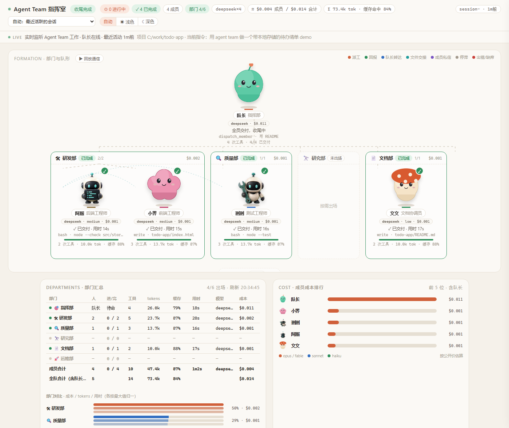
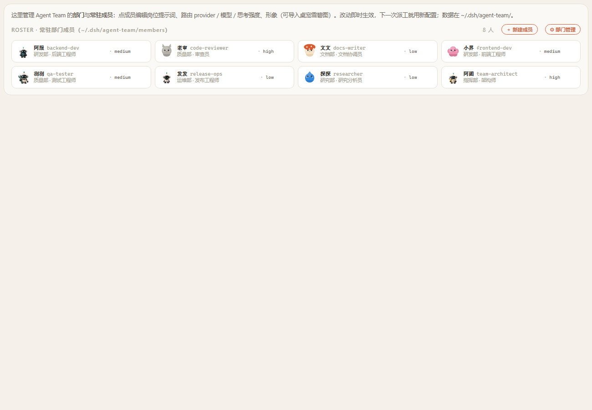

# dsh-agent-team · DeepSeek Harness 的可视化 Agent Team

[](https://github.com/another-bbzj/dsh-agent-team/actions/workflows/test.yml)
[](https://www.npmjs.com/package/dsh-agent-team)


给 [DeepSeek Harness](https://github.com/deepseek-ai/deepseek-harness)（`dsh`）装上一支**部门制的 Agent Team**，并把每个子代理的工作**实时画出来**：每人一只不重复的动画桌宠、按部门分组、派工 / 回报 / 文件交接 / 成员私信的连线动画、每个人的 token 与成本、成员 / 部门 / 形象都能在页面上增删改。

它是 [claude-agent-team](https://github.com/another-bbzj/claude-agent-team)（Claude Code 版）的 DSH 移植：看板一模一样，底层完全按 Harness 的生态协议重写——**一个 npm 包 = 一个 bundle**，靠 `session/event` 火线拿数据，靠 `ctx.subagents` 派工，靠 `ctx.webServer` 挂页面，任何模型路由（DeepSeek 官方、OpenAI 兼容中转、自建）都能用。



<p align="center"></p>

## 30 秒看懂

| 你会得到 | 说明 |
|---|---|
| **一个工具 `dispatch_member`** | 队长（你正在聊的那个 Agent）用它把任务派给常驻成员；成员各有岗位提示词、模型路由、思考强度。同一回合可并行派多人 |
| **8 位常驻成员 · 6 个部门** | 指挥部 team-architect；研发部 backend-dev / frontend-dev；质量部 qa-tester / code-reviewer；研究部 researcher；文档部 docs-writer；运维部 release-ops。全部是 `~/.dsh/agent-team/members/*.md`，随便改、随便加 |
| **队长的系统提示词** | 自动注入一段成员表与派工规范（子代理不注入，省 token） |
| **看板** | DSH Web 右下角「Agent Team」按钮 → 滑出面板；或直接开 `http://127.0.0.1:3080/agent-team/`；另有**独立端口 `http://127.0.0.1:7790/`**（不依赖 DSH 登录令牌，headless 也有；7790 避开 Claude Code 版的 7788，可改）。实时动画、部门汇总、成本排行、回放通信、深浅主题 |
| **DSH 设置里的卡片** | 设置 → 插件 → 插件配置 → **Agent Team · 部门与成员**：在 DSH 自己的设置页里增删改部门、成员（岗位提示词 / 路由 / 模型 / 思考强度 / 形象）、导入桌宠；端口、派工 provider 等开关也在同一命名空间 `agent-team` 下 |
| **token / 成本** | 直接用 Harness 每步 `assistant/message` 里的真实 `usage`（输入 / 输出 / 缓存命中，口径与 DeepSeek 后台一致）；成本按 `provider/model` 最长前缀匹配内置价格表，认不出的模型显示「未定价」而不是瞎算 |
| **形象** | 自带 13 只（MIT）；桌宠雪碧图（Codex / petdex 格式）拖进来就能用；正在工作的成员也能当场换形象；主体偏小的形象自动按动作放大 |
| **不会“一装就崩”** | 纯 ESM JavaScript、不需要构建（唯一依赖是 DSH 自己的 schema 库 `@deepseek-ai/schemastery`，缺了也只是没设置卡片）；只硬依赖 `sessions` 服务，其余（tools / subagents / systemPrompt / webServer）都是"服务到了才挂"——headless、ACP 这类没有 Web 的组合照样能装、能派工，只是没看板 |

## 三分钟装好

前提：已经能跑 `dsh web`（`npx @deepseek-ai/dsh web` 或全局安装的 `dsh`）。

```bash
# 从 npm（推荐）
dsh plugin --profile web add dsh-agent-team

# 或从 GitHub（纯 JS，没有构建步骤，所以不会遇到 pnpm 的 allowBuilds 拦截）
dsh plugin --profile web add github:another-bbzj/dsh-agent-team

# 或本地开发
git clone https://github.com/another-bbzj/dsh-agent-team
dsh plugin --profile web add link:/绝对路径/dsh-agent-team
```

然后正常启动：

```bash
dsh web
```

终端会多三行：

```
[dsh-agent-team] v0.2.0 已加载：工具 dispatch_member，8 位成员
[dsh-agent-team] 独立看板 http://127.0.0.1:7790/agent-team/
[dsh-agent-team] 看板 http://127.0.0.1:3080/agent-team/
```

Web 页面右下角出现 **Agent Team** 按钮。卸载：`dsh plugin --profile web remove dsh-agent-team`。

> 其它 profile（`headless`、自建 profile）同样 `dsh plugin --profile <name> add dsh-agent-team`。没有 Web 服务的组合会自动只装派工部分。

## 第一次使用：完整走一遍

1. 打开 `dsh web`，选一个工作区，对队长说：

   > 用 agent team 做一个带本地存储的待办清单 demo

2. 队长的系统提示词里已经有成员表，它会调 `dispatch_member` 派人（通常一回合派 2-4 位并行）。点右下角 **Agent Team**：每位成员一只桌宠从队长身边飞到自己的部门，卡片上是当前工具调用、用时、tokens、成本。
3. 成员回报后队长汇总。看板收尾时会提示"建议补位"（比如 ≥ 2 人写了代码但质量部没出场）——这是建议，不是错误。
4. 想让某位成员用更强的模型：DSH **设置 → 插件 → Agent Team**（或看板底部的成员表）→ 点成员 → **路由 provider / 模型 / 思考强度** 填上（provider 是 DSH 里注册的路由名，模型 id 是该路由下的 id）。留空 = 跟随队长当前路由。
5. 想加一个新岗位：同一页 **新建成员** → 填标识（如 `security-reviewer`）、部门、简介（队长靠这句挑人）、系统提示词、形象（可导入桌宠 zip / webp / png）→ 保存。下一次派工就能用。**部门管理** 在旁边。

## 团队是怎么协作的

```
用户 ──► 队长（你聊天的 Agent；读到成员表）
           │ dispatch_member(member, description, prompt)   ← 一回合可并行多个
           ▼
   ┌────────────────────────────────────────────────┐
   │ 子代理（ctx.subagents.start('spawn', …)）        │
   │  · persona = 成员的岗位提示词（deployment:persona-prefix） │
   │  · agentOptions = 成员的 provider / model / effort  │
   │  · 完成后把最后一条回复原样返回给队长              │
   └────────────────────────────────────────────────┘
           │ session/event 火线（turn / step / tool/call / tool/result / assistant/message+usage）
           ▼
   看板 store（进程内）──► /agent-team/snapshot.json ──► 页面 1.5s 轮询
```

- 成员之间靠项目里的 `.team/` 办公目录交流：`SPEC.md`、`tickets/NN-*.md`、`inbox/<成员id>.md`、`handoffs/NN-*.md`。派工 prompt 只给路径指针；成员汇报 ≤ 200 字（产出 / 偏差 / 风险）。看板把"B 读了 A 写过的文件"画成交接线，把 `send_message` 画成私信线。
- 部门"出场建议"：研发部有人写代码 → 建议质量部；≥ 2 人写代码 → 建议文档部。用不到的部门不必凑人。
- 临时派的 `subagent`（DSH 自带工具）也会显示：标题写成「部门名·任务」就归到对应部门，否则进研发部。

## 成员与模型：适配所有路由

成员文件 `~/.dsh/agent-team/members/<id>.md`：

```markdown
---
name: backend-dev
description: 阿服·后端工程师（研发部）。实现数据层、算法、API 时使用。
provider: deepseek-official        # 可选：DSH 里注册的路由名；留空 = 跟随队长
model: deepseek-v4-flash           # 可选：该路由下的模型 id；留空 = 跟随队长
effort: medium                     # 可选：思考强度；只在该路由声明支持时才会发
color: blue
dept: dev
---
你是研发部的后端工程师「阿服」……（岗位提示词）
```

关于**思考强度**的一个细节：Harness 对不支持的 `reasoningEffort` 会在子代理准备请求时直接报错（不是降级）。所以插件在派工前会用 `ctx.llm.resolveModelInfo()` 查一下目标路由声明的档位——支持才发，`xhigh/max` 自动映射到 `high`，查不到就不发；万一子代理还没干活就出错，再去掉所有覆盖参数重试一次。这一条是在真实 Harness 上跑出来的坑，不是猜的。

模型 id 可以是任何东西：`deepseek-v4-pro`、`DeepSeek-V4-Flash (1.20x)`（中转站带倍率的 id）、`gpt-5.6-terra`、`glm-5`……看板按 id 归家族着色、按价格表计价。

## token 与成本口径

- 每步的 `usage` 来自 Harness 的 `assistant/message` 事件：`inputTokens`（未命中缓存的输入）+ `cacheReadTokens` + `cacheWriteTokens` + `outputTokens`（含 reasoning）。DeepSeek 的 `prompt_tokens` 已被适配器拆成"命中 / 未命中"，看板直接相加，与 DeepSeek 后台账单口径一致。
- 价格表在 `~/.dsh/agent-team/team.json` 的 `pricing_usd_per_mtok`（USD / 百万 token），**按 `provider/model` 最长前缀 → `model` 最长前缀 → 家族名** 匹配。内置 DeepSeek / OpenAI / Gemini / Qwen / GLM / Kimi / MiniMax / Grok / Llama / Mistral 常见型号；中转站或私有路由加一行 `"my-relay/deepseek": {...}` 即可，页面即时生效。
- 认不出的模型：成本显示 **未定价**，顶栏黄色提示，不会把它算成别的价。

## 看板功能

| 区域 | 内容 |
|---|---|
| 顶栏 | 阶段（组队 / 协调 / 等待 / 收尾）、进行中 / 已完成、模型分布、成员成本 / 全队合计、tokens 与缓存命中率、会话选择（自动 = 最近活跃）、主题 |
| 舞台 | 队长在上、部门在下；成员桌宠按状态播放不同动画（思考 / 跑动 / 挥手交付 / 失败 / 等待）；派工、回报、转达、交接、私信、停滞、出错各有颜色的连线 |
| 任务卡片 | 每位成员一张：状态、任务标题、当前工具、用时、tokens、成本 |
| 部门汇总 | 人数 / 进度 / 工具次数 / tokens / 缓存 / 用时 / 模型 / 成本，含队长与全队合计，对比条 |
| 成本排行 | 含队长，按家族着色 |
| 详情抽屉 | 点任何一位：形象（当场换 / 只改这位 / 改这个角色 / 导入）、任务指令、概况、写过的文件、通信、交付回报、动作时间线 |
| 常驻成员 | 全部成员定义；新建 / 编辑 / 删除；部门管理 |
| 回放 | 把本次会话的通信按时间重放一遍 |

## 形象（桌宠）

自带 13 只（4 只来自 [cc-haha](https://github.com/NanmiCoder/cc-haha)，9 只程序化绘制，均 MIT）。看板与 Codex 桌宠、[petdex](https://petdex.dev) 画廊用**同一种雪碧图格式**（8 列 × 9 或 11 行，每帧 192×208，webp / png，通常打包成 `pet.json + spritesheet.webp` 的 zip）：

- 成员表单 → 形象旁 **「导入形象…」** → zip / webp / png；或详情抽屉 → **导入…** 直接用到正在工作的那位身上。
- 导入的形象放在 `~/.dsh/agent-team/sprites/`，旁边 `<id>.json` 记名字、作者与来源。
- 主体偏小 / 各动作大小不一的形象，看板在浏览器里按动作识别主体自动放大，不裁切。

> 仓库不附带 Codex / petdex 的形象：版权分别属于 OpenAI 与各位作者。

## 配置

`cordis.patch.yml` 里的一行插件，全部字段可在你 profile 的 `cordis.patch.yml` 里覆盖（按 id `dsh-agent-team`；注意 patch 是整段替换 `config`）：

```yaml
- id: dsh-agent-team
  name: dsh-agent-team
  config:
    subagentProvider: spawn      # 派工用的子代理 provider：spawn（默认，最省）/ fork（继承队长历史）
    toolName: dispatch_member    # 队长看到的工具名
    promptSection: true          # 往队长的系统提示词里加成员表
    promptOrder: 5000            # 提示词片段的顺序（外部片段任意有限数即可）
    maxPromptChars: 20000        # 单次派工 prompt 上限，防止把整段文件贴进去
    board: true                  # 挂看板（需要 Web 服务）
    basePath: /agent-team        # 看板路径
    port: 7790                   # 独立端口（0 = 不开）。默认避开 Claude Code 版的 7788
    launcher: true               # Web UI 右下角按钮
    checkUpdates: true           # 12 小时查一次 npm 新版本（只提示，不自动装）
```

其中 `port / subagentProvider / toolName / launcher / checkUpdates / promptSection` 也注册成了 DSH 的设置命名空间 `agent-team`，可以在 **设置 → 插件 → Agent Team** 里改（端口与工具名重启生效）。

### 端口

| 端口 | 谁在用 |
|---|---|
| 3080 | DSH Web 本体（看板挂在它的 `/agent-team/` 下，需要登录令牌） |
| **7790** | 本插件的独立看板（默认；可改 / 关闭） |
| 7788 | Claude Code 版 claude-agent-team 的看板——两者可以同时开 |

端口被占用时只打一行警告，不影响启动。

数据目录 `~/.dsh/agent-team/`（`DSH_HOME` 可改；`DSH_AGENT_TEAM_HOME` 可单独指定）：

```
team.json        部门、成员登记（部门 / 显示名 / 岗位 / 形象）、正在工作成员的临时形象、价格表
members/*.md     成员定义（岗位提示词 + provider / model / effort）
sprites/         你导入的形象
```

更新插件不会碰这个目录。

## 排错

| 现象 | 原因 / 处理 |
|---|---|
| 终端没有 `[dsh-agent-team] 已加载` | 看 `dsh --profile web --dump-config` 里有没有 `# == dsh-agent-team` 层；没有说明 `dsh plugin add` 没成功（包里需要 `dsh.bundle`） |
| 有「已加载」没有「看板」行 | 这个 profile 没有 Web 服务（headless / ACP）；派工可用，看板走独立端口 `http://127.0.0.1:7790/` |
| 设置里没有 Agent Team 卡片 | Host 半边注册设置命名空间需要 `@deepseek-ai/schemastery`（随包安装）；看终端有没有「设置卡片未注册」；`dsh plugin --profile web add dsh-agent-team` 重装一次会补齐依赖 |
| 派工返回「成员 X 未正常完成（error）」 | 多半是成员里填的 provider / model 在这个 DSH 里不存在或没配 key。清空成员的路由字段试试；或 `DSH_AGENT_TEAM_DEBUG=1 dsh web` 看详细日志 |
| 成本显示未定价 | 模型不在价格表：往 `team.json` 加一行 `"<provider>/<model 前缀>"` |
| 想看看板数据但没有 Web | `DSH_AGENT_TEAM_DUMP=/tmp/snap.json dsh --profile headless "…"`，每回合结束写一份 snapshot |
| 想不装 DSH 先看看效果 | `node scripts/demo.mjs` → http://127.0.0.1:7789/agent-team/ ，脚本化演一场四人协作 |

## 自检与测试

```bash
npm test                      # node --test：状态折叠、定价、派工工具、退化重试、看板 API、headless 组合
node scripts/demo.mjs         # 本地演示看板
node scripts/mock-llm.mjs     # 脚本化的 OpenAI 兼容 mock 模型（零成本端到端）
```

端到端验证方式（本仓库发布前跑过）：在一个空 `DSH_HOME` 里 `npm i @deepseek-ai/dsh@latest` → `dsh plugin --profile web add link:…` → `dsh web` 启动、页面与全部路由可用；`dsh --profile headless` 配合 `mock-llm.mjs`：队长调 `dispatch_member` 派两位成员 → 子代理以成员 persona 运行 → 队长汇总，看板快照里两位成员各归其部门、状态 completed、usage 与 DeepSeek 口径一致。

## 目录结构

```
lib/index.js        插件入口（单行 bundle）：状态折叠 + dispatch_member + 队长提示词 + 按需挂看板
lib/board.js        看板 HTTP 路由 / 管理 API / 启动按钮注入 / 独立端口
lib/client.js       浏览器半边：DSH 设置页里的「Agent Team」卡片（lazy-CJS factory，手写，无需构建）
lib/store.js        session/event → 每个会话的画像（队长 / 成员）
lib/snapshot.js     画像 → snapshot.json（部门、通信、汇总、排行）
lib/team.js         team.json、成员文件、部门、形象、价格
assets/index.html   看板前端（单文件，与 claude-agent-team 共用）
assets/members/     8 位默认成员 · assets/sprites/ 13 只自带形象 · assets/team.json 默认配置与价格表
scripts/            demo.mjs（本地演示）· mock-llm.mjs（零成本端到端）
test/               node --test
```

## 与 Claude Code 版的差异

| | claude-agent-team | dsh-agent-team |
|---|---|---|
| 数据来源 | 读 `~/.claude/projects` 转录文件 | 进程内 `session/event` 火线（无文件解析、无延迟） |
| 派工 | Claude Code 原生 `Agent` 工具 + `~/.claude/agents/*.md` | 插件自己的 `dispatch_member` → `ctx.subagents.start`，成员 = persona + 路由 |
| 模型 | Claude 家族 | 任意路由：DeepSeek 官方、OpenAI 兼容中转、自建适配器 |
| 服务 | 独立 Python 进程 :7788 | 挂在 DSH 自己的 Web 服务上，随 `dsh web` 启停 |
| 安装 | `python install.py` | `dsh plugin add`（bundle 协议） |

## 致谢

思路来自 [cc-haha](https://github.com/NanmiCoder/cc-haha) 的 Agent Teams 工作台；token 规则借鉴 [ponytail](https://github.com/DietrichGebert/ponytail) 与 [mattpocock/skills](https://github.com/mattpocock/skills)；插件写法参考了 [dsh-whale-widget](https://github.com/MeteorNOX/DeepSeek-Balance-Whale-Widget) 等社区插件与 Harness 官方文档。

## License

MIT
